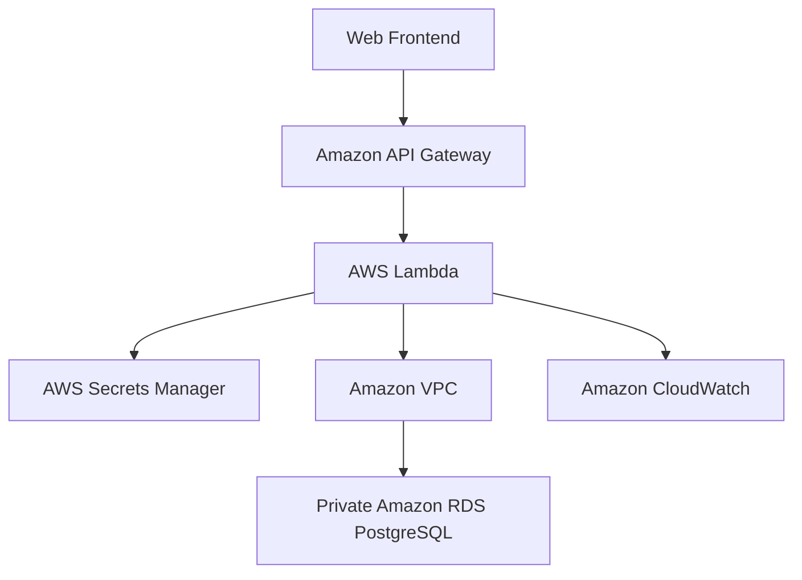

# AWS Student Portal

A full-stack Student Management application built to demonstrate AWS cloud engineering, serverless computing, private database connectivity, and secure credential management.

## Project Overview

The AWS Student Portal allows users to view student records and add new students through a web dashboard. The application uses Amazon API Gateway and AWS Lambda to handle requests, Amazon RDS PostgreSQL to store records, and AWS Secrets Manager to retrieve database credentials securely.

## Architecture



## Tech Stack

**Frontend**
- HTML5
- CSS3
- JavaScript

**Backend**
- Python 3.13
- AWS Lambda
- Amazon API Gateway

**Database and Security**
- Amazon RDS for PostgreSQL
- AWS Secrets Manager
- AWS Identity and Access Management (IAM)
- Amazon VPC and security groups

**Monitoring**
- Amazon CloudWatch Logs

## Features

- View student records from a PostgreSQL database.
- Add students using a web form.
- Retrieve records through an HTTP API.
- Store database records persistently.
- Keep the database in a private network configuration.
- Retrieve the database password from AWS Secrets Manager rather than a Lambda environment variable.
- Log execution details for troubleshooting through CloudWatch.

## API Endpoints

| Method | Route | Description |
|---|---|---|
| GET | `/students` | Retrieve student records |
| POST | `/students` | Add a student record |

The API Gateway deployment URL is intentionally not included because the cloud resources may be removed after project documentation is complete.

## Security Implementation

- Stored database credentials in AWS Secrets Manager.
- Granted the Lambda execution role permission to retrieve the designated secret.
- Configured Lambda to access the private PostgreSQL database through a VPC.
- Used security groups to control network access.
- Enabled CloudWatch logging for troubleshooting.

## Testing

The following operations were tested successfully:

- GET request returned student records.
- POST request inserted a new student record.
- Lambda retrieved the database password from Secrets Manager.
- Lambda connected successfully to PostgreSQL.
- The frontend loaded records and added students successfully.

Screenshots documenting these tests are available in the `screenshots/` directory.

## Repository Structure

```text
aws-student-portal/
├── frontend/
│   ├── index.html
│   ├── style.css
│   └── app.js
├── lambda/
│   ├── lambda_function.py
│   └── requirements.txt
├── screenshots/
├── .gitignore
└── README.md
```

## Running Locally

1. Clone this repository.
2. Open `frontend/index.html` in a browser.
3. Configure the frontend with your own deployed API endpoint to use the live backend.

The backend requires AWS resources and configuration, including Lambda, API Gateway, Secrets Manager, and PostgreSQL. Refer to the AWS documentation before deploying your own environment.

## Security Notice

Never commit AWS access keys, database passwords, secret values, private configuration files, or other credentials to GitHub.

The screenshots and source code in this repository are intended for educational and portfolio purposes.

## Author

**Amarjit Bhuj**  
B.Tech Computer Science and Engineering  
University of Lucknow

